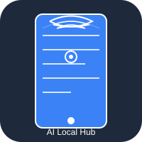

# AI-Local-Hub 🤖📱

[](https://www.python.org/downloads/)
[](https://opensource.org/licenses/MIT)
[](https://github.com/JohanCarrion1/AI-Local/stargazers)
[](https://github.com/JohanCarrion1/AI-Local/issues)

**Aplicación local para gestionar, descargar y ejecutar modelos de IA (código + visión) adaptada a los recursos de tu dispositivo.**

---

## 🎯 Características

✅ **Descarga automática de modelos** (HuggingFace, GitHub)
✅ **Detección de recursos** (RAM, VRAM, SO) para recomendar modelos compatibles
✅ **Soporte para móvil** (Termux en Android) y escritorio
✅ **Interfaz CLI y GUI** (Streamlit)
✅ **Integración con GitHub** (vía token para repositorios privados)
✅ **Ejecución local 100%** (sin dependencias de cloud)
✅ **Modelos optimizados** para 4B-7B (móvil) y 14B+-72B (PC)

---

## 📱 Compatibilidad con Dispositivos

| **Dispositivo**       | **RAM/VRAM** | **Modelos Recomendados**                          | **Herramienta**       |
|------------------------|--------------|--------------------------------------------------|------------------------|
| **Móvil (A36)**        | 4-6GB        | Qwen3 8B (Q4), Phi-3.5-mini, MobileVLM-7B        | Termux + Ollama       |
| **PC (16GB RAM)**      | 16GB         | Qwen3.8-27B, Qwen2.5-VL-7B, DeepSeek-Coder-7B     | Ollama / Local        |
| **PC (24GB+ RAM)**     | 24GB+        | Qwen3.8-27B, Qwen2.5-VL-32B, Llama 3.2 70B       | Ollama / Local        |
| **PC (48GB+ RAM)**     | 48GB+        | Qwen3-Coder-480B, Qwen2.5-VL-72B, Kimi-Dev-72B   | Ollama / Local        |

---

## 🚀 Instalación

### 📱 En Android (Termux)

1. **Instalar Termux y Termux:PR** (desde F-Droid)
2. **Actualizar paquetes:**
   ```bash
   pkg update && pkg upgrade
   pkg install git python python-pip
   pip install --upgrade pip
   ```
3. **Instalar Ollama (para modelos):**
   ```bash
   pkg install wget
   wget https://ollama.ai/install.sh
   bash install.sh
   ```
4. **Clonar el repositorio:**
   ```bash
   git clone https://github.com/JohanCarrion1/AI-Local
   cd AI-Local
   pip install -r requirements.txt
   ```

### 💻 En PC (Linux/Mac/Windows)

1. **Clonar el repositorio:**
   ```bash
   git clone https://github.com/JohanCarrion1/AI-Local
   cd AI-Local
   ```
2. **Crear entorno virtual:**
   ```bash
   python -m venv venv
   source venv/bin/activate  # Linux/Mac
   .\venv\Scripts\activate   # Windows
   ```
3. **Instalar dependencias:**
   ```bash
   pip install -r requirements.txt
   ```
4. **Opcional: Instalar Ollama (para gestión de modelos):**
   - [Descargar Ollama](https://ollama.ai)

---

## 🛠️ Uso

### 🔹 CLI (Interfaz de Línea de Comandos)

```bash
# Ver ayuda
python -m app.cli.main --help

# Detectar recursos del dispositivo
python -m app.cli.main detect

# Listar modelos compatibles
python -m app.cli.main models --list

# Descargar modelo (ej: Qwen3 8B)
python -m app.cli.main download --model=qwen3:8b --source=ollama

# Descargar desde HuggingFace
python -m app.cli.main download --model=Qwen/Qwen3-Coder-7B --source=huggingface

# Descargar desde GitHub (con token)
python -m app.cli.main github connect --token=ghp_xxxxx
python -m app.cli.main download --repo=user/model-repo --source=github

# Ejecutar inferencia
python -m app.cli.main run --model=qwen3:8b --prompt="Explica qué es Python"

# Listar modelos descargados
python -m app.cli.main models --local
```

### 🎨 GUI (Interfaz Gráfica con Streamlit)

```bash
# Iniciar la interfaz web
streamlit run app/gui/app.py
```

Abre tu navegador en `http://localhost:8501`

---

## 📦 Modelos Soportados

### 🔥 Para Programación (Código)

| Modelo | Tamaño | VRAM Mínima | Descarga | Recomendado para |
|--------|--------|-------------|----------|------------------|
| Qwen3 8B | 8B | 6GB | `ollama run qwen3:8b` | Móvil/PC |
| Qwen2.5-Coder-7B | 7B | 5GB | [HF](https://huggingface.co/Qwen/Qwen2.5-Coder-7B) | Móvil |
| DeepSeek-Coder-7B | 7B | 5GB | [HF](https://huggingface.co/deepseek-ai/DeepSeek-Coder-7B) | Móvil |
| Phi-3.5-mini | 3.8B | 3GB | `ollama run phi3.5:mini` | Móvil |
| Qwen3.8-27B | 27B | 24GB | `ollama run qwen3:27b` | PC |
| Qwen3-Coder-480B | 480B | 80GB+ | [HF](https://huggingface.co/Qwen) | Servidor |

### 🖼️ Multimodales (Imágenes + Texto)

| Modelo | Tamaño | VRAM Mínima | Descarga | Recomendado para |
|--------|--------|-------------|----------|------------------|
| MobileVLM-7B | 7B | 5GB | [HF](https://huggingface.co/VisualGLM/MobileVLM-7B) | **Móvil (A36)** |
| PaliGemma-3B | 3B | 4GB | [HF](https://huggingface.co/google/paligemma-3b-mix-224) | Móvil |
| Qwen2.5-VL-7B | 7B | 8GB | [HF](https://huggingface.co/Qwen/Qwen2.5-VL-7B) | PC |
| Qwen2.5-VL-32B | 32B | 24GB | [HF](https://huggingface.co/Qwen/Qwen2.5-VL-32B) | PC |

---

## 🔐 Configuración de GitHub Token

1. **Generar un Personal Access Token (PAT) en GitHub:**
   - Ve a [Settings > Developer Settings > Personal Access Tokens](https://github.com/settings/tokens)
   - Crea un token con scopes: `repo`, `read:org`
   - Copia el token (ej: `ghp_xxxxxxxxxxxxxxxxxxx`)

2. **Guardar el token en la app:**
   ```bash
   python -m app.cli.main github connect --token=ghp_xxxxx
   ```
   *(El token se guardará encriptado en tu sistema)*

3. **Clonar repositorios privados:**
   ```bash
   python -m app.cli.main download --repo=usuario/repo-privado --source=github
   ```

---

## 📂 Estructura del Proyecto

```
AI-Local/
├── app/
│   ├── cli/
│   │   └── main.py          # Interfaz CLI
│   ├── gui/
│   │   └── app.py           # Interfaz GUI (Streamlit)
│   ├── core/
│   │   ├── model_manager.py # Gestor de descargas
│   │   ├── executor.py      # Ejecutor de modelos
│   │   ├── github_connector.py # Integración GitHub
│   │   └── resource_detector.py # Detección de hardware
│   ├── db/
│   │   └── database.py      # Base de datos SQLite
│   └── utils/
│       ├── security.py      # Manejo de tokens
│       └── config.py        # Configuraciones
├── models/                  # Modelos descargados (en .gitignore)
├── assets/
│   ├── icon/
│   │   ├── icon.svg         # Icono del proyecto
│   │   └── icon.png
│   └── screenshots/
├── docs/
│   ├── setup.md            # Guía de instalación
│   └── models.md            # Lista detallada de modelos
├── .github/
│   └── workflows/
│       └── ci.yml           # Integración continua
├── requirements.txt
├── pyproject.toml
├── LICENSE
└── README.md
```

---

## 📜 Licencia

Este proyecto está bajo la **Licencia MIT** - mira el archivo [LICENSE](LICENSE) para más detalles.

---

## 🤝 Contribuir

¡Las contribuciones son bienvenidas! Abre un **Issue** o envía un **Pull Request**.

---

## 🙏 Agradecimientos

- [Qwen Team](https://github.com/QwenLM) - Por los modelos Qwen
- [Ollama](https://ollama.ai) - Por la gestión local de modelos
- [HuggingFace](https://huggingface.co) - Por el hub de modelos
- [Streamlit](https://streamlit.io) - Por la interfaz GUI

---

**📌 Nota:** Los modelos de IA pueden tener requisitos de hardware específicos. Usa el comando `detect` para ver qué modelos son compatibles con tu dispositivo.

---

<p align="center">
  
  <br>
  <strong>AI-Local-Hub</strong> - Tu centro de IA local
</p>
